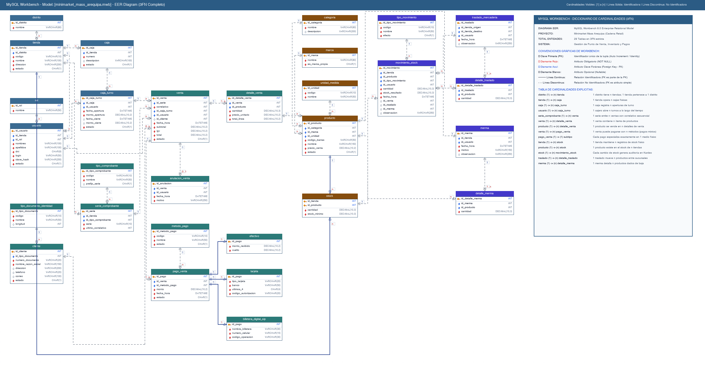

# Minimarket Mass - Sistema de Base de Datos y Facturación
Sistema relacional y lógica de negocio para la administración de ventas, inventario y facturación de la cadena Minimarket Mass en Arequipa (SENATI CFP Arequipa).

## Integrantes del Grupo
- ERICK SILVA AYQUIPA
- Gerald Anderson Condori Quispe
- Alexander Emmanuel Moreno Flores
- Jhon Alexandro Apaza Belizario
- Suhaily Luana Huaypar Quijhua
- Keymer Cesar Machaca Puma

## Estructura del Repositorio
El repositorio cuenta con una arquitectura modular en scripts SQL y documentación técnica:

- **`database/schema.sql`**: Script DDL que crea la base de datos `minimarket_mass` y sus **26 tablas relacionales** organizadas en 7 niveles de dependencia, con claves foráneas, restricciones de unicidad y validaciones `CHECK`.
- **`database/datos.sql`**: Script DML con datos de prueba realistas (3 tiendas en Arequipa: Cayma, Cerro Colorado y Yanahuara, personal, catálogo de productos, existencias en stock, ventas, turnos de caja y auditoría en kardex).
- **`database/consultas.sql`**: Consultas comerciales categorizadas que resuelven preguntas clave del negocio (catálogo, personal, inventario y reposición, ventas, facturación y arqueo de cajas).
- **`database/boleta.sql`**: Vista `vw_comprobante` y procedimiento almacenado `sp_boleta(serie, correlativo)` para generar la impresión completa del comprobante (cabecera, detalle y desglose de pagos).
- **`database/ajustes.sql`**: Migración del ajuste por conteo físico: tabla `ajuste_inventario`, tipos de movimiento AJUSTE DE ENTRADA y DE SALIDA, y `movimiento_stock.id_ajuste` como cuarto origen.
- **`database/seguridad.sql`**: Tabla `intento_login` para bloquear un rato a quien prueba muchas claves.
- **`database/ingresos.sql`**: Ingreso de mercadería: tablas `ingreso_mercaderia` y `detalle_ingreso` (documento del emisor, cantidades y costo) y su movimiento en el kardex.
- **`database/operaciones.sql`**: Devoluciones parciales (`devolucion_venta`, `detalle_devolucion`), retiros e ingresos de efectivo en la caja (`movimiento_caja`), la fecha de vencimiento de cada lote recibido y 3 ingresos de ejemplo para la pantalla **Por vencer**.
- **`database/catalogo.sql`**: Catálogo de ejemplo de un minimarket de Arequipa: 82 productos más de marcas reales (Laive, Coca-Cola, San Fernando, Bimbo, Field, Sapolio...) con precios de referencia, 4 categorías nuevas y su primer ingreso en las 3 tiendas. **`database/catalogo_inicial.csv`** es el mismo catálogo en CSV, para importarlo desde la pantalla **Importar CSV**.
- **`database/auditoria.sql`**: Tabla `auditoria`, la bitácora de acciones sensibles (anulaciones, cambios de precio, personal, claves y tiendas).
- **`database/login.sql`**: Agrega la columna `clave_hash` a `empleado` con el hash bcrypt de la clave de prueba, para el login de la aplicación.
- **`final.docx`**: Informe de análisis y modelado en Word (5 diagramas UML: casos de uso, secuencia, actividades, componentes y despliegue).
- **`docs/diseno_bd.md`**: Especificación técnica completa, diccionario de datos y detalle de reglas de negocio para las 26 tablas.
- **`docs/diagrama-er.png`**: Diagrama Entidad-Relación visual de alta resolución (sin colisiones en relaciones).
- **`docs/manual_usuario.md`**: Manual de uso por rol (administrador, cajero y almacenero).
- **`docs/despliegue.md`**: Instalación en el aula o en un servidor, respaldos, actualización y problemas comunes.
- **`docs/seguridad.md`**: Qué protege la aplicación (CSRF, escapado, SQL preparado, roles, sesión) y cómo se comprueba.
- **`scripts/`**: Respaldo y restauración de la base (`respaldo.ps1`, `restaurar.ps1` y sus versiones `.sh`), el respaldo diario automático (`programar_respaldo`) y la revisión antes de abrir la tienda (`verificar_instalacion.php`).
- **`docs/propuesta_sunat_y_lector.md`**: Propuesta (sin implementar) para emitir boletas y facturas electrónicas ante SUNAT y vender con lector de código de barras.
- **`deploy/`**: Configuración de Apache y Nginx con HTTPS para publicar el sistema en un servidor.

---

## Diagrama Entidad-Relación (EER)



---

## Tablas del Sistema (26 Tablas en 7 Niveles)

El diseño está optimizado y estructurado por niveles de integridad referencial:

| N° | Nivel | Tabla | Descripción |
|---|---|---|---|
| 1 | **Nivel 1** | `distrito` | Distritos de Arequipa con sedes de Tiendas Mass (Cayma, Cerro Colorado, Yanahuara). |
| 2 | **Nivel 1** | `rol` | Roles operativos del personal: ADMINISTRADOR, CAJERO y ALMACENERO. |
| 3 | **Nivel 1** | `cliente` | Registro de clientes con validación estricta de DNI (8 dígitos) y/o RUC (11 dígitos). |
| 4 | **Nivel 1** | `categoria` | Familias del catálogo (Abarrotes, Lácteos, Bebidas, Frutas y verduras, Limpieza). |
| 5 | **Nivel 1** | `marca` | Marcas comerciales, identificando si es marca propia de la cadena (S/N). |
| 6 | **Nivel 1** | `unidad_medida` | Unidades de cuantificación (unidad `und`, kilogramo `kg`, litro `lt`). |
| 7 | **Nivel 1** | `tipo_comprobante` | Comprobantes de pago autorizados: BOLETA (serie B) y FACTURA (serie F). |
| 8 | **Nivel 1** | `metodo_pago` | Medios de pago aceptados: EFECTIVO, TARJETA y BILLETERA DIGITAL SIP. |
| 9 | **Nivel 1** | `tipo_movimiento` | Catálogo de tipos de kardex con efecto de Entrada (`E`) o Salida (`S`). |
| 10 | **Nivel 2** | `tienda` | Sedes físicas de Tienda Mass en Arequipa vinculadas a su respectivo distrito. |
| 11 | **Nivel 2** | `producto` | Catálogo con precio único unificado para todas las tiendas, código de barras y venta por peso. |
| 12 | **Nivel 3** | `empleado` | Personal con DNI de acceso, tienda asignada y rol operativo. |
| 13 | **Nivel 3** | `caja` | Puntos de venta físicos (cajas registradoras POS) por tienda. |
| 14 | **Nivel 3** | `serie_comprobante` | Series fiscales por tienda (`B001`, `F001`, etc.) y control de su último correlativo emitido. |
| 15 | **Nivel 3** | `stock` | Existencias actuales y stock mínimo por tienda y producto (clave compuesta `id_tienda, id_producto`). |
| 16 | **Nivel 4** | `caja_turno` | Aperturas y cierres de sesión de caja con montos iniciales y control por cajero. |
| 17 | **Nivel 4** | `traslado_mercaderia` | Registro de transferencias de mercadería entre sedes físicas distintas. |
| 18 | **Nivel 4** | `merma` | Bajas de mercadería clasificadas por motivo (VENCIDO, DAÑADO, ROBO, OTRO). |
| 19 | **Nivel 5** | `venta` | Cabecera del comprobante fiscal (serie, correlativo, total, turno de caja y cliente). |
| 20 | **Nivel 6** | `detalle_venta` | Líneas de venta con cantidad, precio unitario histórico al momento de venta e importe calculado. |
| 21 | **Nivel 6** | `anulacion_venta` | Registro único de auditoría para anulación de comprobantes por el personal autorizado. |
| 22 | **Nivel 6** | `pago_venta` | Pagos aplicados a la venta que garantizan la liquidación total o combinada. |
| 23 | **Nivel 7** | `efectivo` | Subtipo de pago en efectivo con registro de monto recibido y vuelto entregado. |
| 24 | **Nivel 7** | `tarjeta` | Subtipo de pago bancario (Débito/Crédito), marca y resguardo de últimos 4 dígitos. |
| 25 | **Nivel 7** | `billetera_digital_sip` | Subtipo de cobro por billetera Sip mediante código QR o Tarjeta Sip con código de operación. |
| 26 | **Nivel 7** | `movimiento_stock` | Kardex permanente que audita cada variación de existencias vinculado a venta, traslado o merma. |

---

## Reglas de Negocio Implementadas

| Regla | Descripción | Mecanismo en la Base de Datos |
|---|---|---|
| **RN-01: Documentos de Cliente** | DNI debe tener 8 dígitos numéricos, RUC 11 dígitos. Debe existir al menos uno. | `CHECK (dni REGEXP '^[0-9]{8}$')`, `CHECK (ruc REGEXP '^[0-9]{11}$')` y `CHECK (dni IS NOT NULL OR ruc IS NOT NULL)`. |
| **RN-02: Serie de Comprobante** | Boletas inician con letra `B` y Facturas con letra `F`, seguidas de 3 dígitos. | `CHECK (serie REGEXP '^[BF][0-9]{3}$')` en `serie_comprobante`. |
| **RN-03: Correlativo Secuencial** | Serie y número correlativo forman una combinación única irrepetible. | `UNIQUE (id_serie, numero_correlativo)` en tabla `venta`. |
| **RN-04: Precio Centralizado** | El precio es uniforme en todas las tiendas y estrictamente positivo. | Columna `precio_venta` en `producto` con `CHECK (precio_venta > 0)`. |
| **RN-05: Existencias No Negativas** | El stock disponible en tienda nunca puede ser inferior a 0. | `CHECK (cantidad_actual >= 0)` en `stock` y `CHECK (stock_nuevo >= 0)` en `movimiento_stock`. |
| **RN-06: Traslados Intertiendas** | Un traslado no puede tener como origen y destino la misma sede física. | `CHECK (id_tienda_origen <> id_tienda_destino)` en `traslado_mercaderia`. |
| **RN-07: Turnos de Caja Coherentes** | Si el turno está abierto, fecha y monto de cierre son nulos. Si está cerrado, son obligatorios y válidos. | `CHECK` compuesto en `caja_turno`. |
| **RN-08: Origen Único de Kardex** | Cada movimiento de inventario procede de exactamente una fuente (venta, traslado o merma). | `CHECK ((id_venta IS NOT NULL) + (id_traslado IS NOT NULL) + (id_merma IS NOT NULL) = 1)` en `movimiento_stock`. |
| **RN-09: Medios de Pago Oficiales** | Tienda Mass opera exclusivamente con Efectivo, Tarjeta y Billetera Digital Sip. | Subtipos relacionales `efectivo`, `tarjeta` y `billetera_digital_sip` vinculados a `pago_venta`. |
| **RN-10: Vuelto en Efectivo** | El vuelto entregado no puede ser negativo ni igual o superior al dinero recibido. | `CHECK (vuelto >= 0 AND vuelto < monto_recibido)` en `efectivo`. |
| **RN-11: Ajuste por Conteo** | Lo contado reemplaza al stock del sistema y la diferencia queda en el kardex como un cuarto origen. | Tabla `ajuste_inventario` y `CHECK` de RN-08 ampliado a 4 orígenes (`database/ajustes.sql`). |
| **RN-12: Permisos por Rol** | Cajero vende y maneja su caja; almacenero recibe mercadería con su documento, traslada, registra mermas y cuenta; administrador anula, ve reportes y maneja personal, catálogo, tienda y cajas. | Métodos `puede...()` de `Usuario` y sus hijas, revisados en el controlador y otra vez en el servicio. |
| **RN-13: Tienda Inactiva** | En una tienda o caja INACTIVA no se abre turno ni se vende, y no recibe traslados. No se desactiva con turnos abiertos. | `models/servicios/` (`CajaServicio`, `VentaServicio`, `InventarioServicio`, `TiendaServicio`). |
| **RN-14: Series sin Huecos** | Cada tienda nueva recibe la siguiente serie libre de la cadena (B004, F004...) y el correlativo solo avanza con cada venta. | `TiendaServicio::abrir()` y `SELECT ... FOR UPDATE` de la serie en `VentaServicio`. |

---

## Cómo Ejecutar la Base de Datos (MySQL)

Si no usas Docker, puedes recrear la base de datos en Laragon (puerto `3307`) o MySQL estándar (puerto `3306`) ejecutando los scripts en el orden indicado. En ese caso pon en `.env` el usuario y la clave de tu MySQL:

```powershell
# 1. Crear base de datos y las 26 tablas
mysql -u root -h 127.0.0.1 -P 3307 -e "source ./database/schema.sql"

# 2. Cargar datos de prueba
mysql -u root -h 127.0.0.1 -P 3307 -e "source ./database/datos.sql"

# 3. Ejecutar consultas y reportes de negocio
mysql -u root -h 127.0.0.1 -P 3307 -e "source ./database/consultas.sql"

# 4. Probar vista y emisión de boleta formateada
mysql -u root -h 127.0.0.1 -P 3307 -e "source ./database/boleta.sql"

# 5. Lo que agrega la aplicación PHP (en este orden): login, intentos de ingreso, ajuste por conteo y auditoría
mysql -u root -h 127.0.0.1 -P 3307 -e "source ./database/login.sql"
mysql -u root -h 127.0.0.1 -P 3307 -e "source ./database/seguridad.sql"
mysql -u root -h 127.0.0.1 -P 3307 -e "source ./database/ajustes.sql"
mysql -u root -h 127.0.0.1 -P 3307 -e "source ./database/auditoria.sql"
mysql -u root -h 127.0.0.1 -P 3307 -e "source ./database/ingresos.sql"
mysql -u root -h 127.0.0.1 -P 3307 -e "source ./database/operaciones.sql"
mysql -u root -h 127.0.0.1 -P 3307 -e "source ./database/catalogo.sql"
```

El diseño base son 26 tablas. La aplicación agrega 8 tablas de apoyo con migraciones: `intento_login` (`seguridad.sql`), `ajuste_inventario` (`ajustes.sql`), `auditoria` (`auditoria.sql`), `ingreso_mercaderia` y `detalle_ingreso` (`ingresos.sql`), y `devolucion_venta`, `detalle_devolucion` y `movimiento_caja` (`operaciones.sql`). Ver `docs/diseno_bd.md`, sección 5.

---

## Cómo Levantar la Base de Datos con Docker (MySQL 8.4.11)

La aplicación PHP lee los datos de MySQL 8.4.11 corriendo en Docker. Necesitas Docker Desktop abierto.

```powershell
# 1. Crear tu archivo de configuración (solo la primera vez) y cambiar las claves
copy .env.example .env

# 2. Levantar MySQL. La primera vez crea la base y ejecuta schema.sql, datos.sql, boleta.sql, login.sql, seguridad.sql, ajustes.sql, auditoria.sql, ingresos.sql, operaciones.sql y catalogo.sql
docker compose up -d

# 3. Esperar a que diga "healthy" (unos 30 segundos la primera vez)
docker compose ps

# 4. Levantar la aplicación
php -S localhost:8000 -t public
```

| Variable de `.env` | Para qué sirve | Valor por defecto |
|---|---|---|
| `DB_HOST` | Dónde está MySQL | `127.0.0.1` |
| `DB_PORT` | Puerto de tu PC que apunta al 3306 del contenedor | `3307` |
| `DB_NAME` | Base de datos | `minimarket_mass` |
| `DB_USER` / `DB_PASSWORD` | Usuario que usa la aplicación (lo crea el contenedor) | `mass_app` |
| `DB_ROOT_PASSWORD` | Clave de root dentro del contenedor | sin valor por defecto |

- El `.env` tiene claves, por eso está en `.gitignore` y **no se sube a GitHub**. En el repositorio solo va `.env.example`.
- Los scripts solo se ejecutan cuando el volumen está vacío. Para volver a cargar `schema.sql` y `datos.sql` desde cero: `docker compose down -v` y luego `docker compose up -d`.
- Si Laragon ya usa el puerto 3307, detén su MySQL o cambia `DB_PORT` en `.env` (por ejemplo a `3308`).
- Para entrar a la consola de MySQL: `docker exec -it minimarket_mass_db mysql -u mass_app -p minimarket_mass`.
- Si MySQL no está corriendo, la aplicación responde 503 con un mensaje, sin mostrar usuario ni claves.

---

## Aplicación PHP con POO y MVC (Sesión 4)

Aplicación en PHP 8.3 sin framework, organizada en Modelo, Vista y Controlador, que cubre las 3 tiendas. Los Repository leen de MySQL con PDO y consultas preparadas (`config/Database.php`). Al pasar de listas fijas a MySQL no cambió ningún controlador ni ninguna vista.

- **`config/Database.php`**: conexión PDO única; lee host, puerto, base, usuario y clave del `.env`.
- **`models/`**: una clase por tabla (`Producto`, `Stock`, `Tienda`, `Caja`, `CajaTurno`, `Cliente`, `SerieComprobante`, `Venta`, `DetalleVenta`, `AnulacionVenta`), los pagos con herencia (`pagos/PagoVenta` → `PagoEfectivo`, `PagoTarjeta`, `PagoSip`), los roles (`Usuario` → `Administrador`, `Cajero`, `Almacenero`) y un Repository por grupo de datos.
- **`controllers/`**: `Controller` (base), `ProductoController`, `VentaController`, `TiendaController`, `AuthController`, `InventarioController`, `CajaController`, `EmpleadoController`, `ClienteController` y `ReporteController`. Validan la entrada, piden datos y eligen la vista.
- **`views/`**: catálogo, ficha, stock de las 3 tiendas, ventas, comprobante, tiendas y 404.
- **`public/index.php`**: único punto de entrada; también están las páginas de prueba `poo_*.php`.
- **`docs/mvc.md`**: guía del MVC, reglas y seguridad.
- **`docs/explicacion_archivos.md`**: qué hace cada archivo, para estudiar antes de la entrega.
- **`docs/reparto.md`**: comandos git por integrante si se pide un Pull Request por persona.
- **`docs/bitacora_ia.md`**: bitácora del uso de IA.

```powershell
docker compose up -d                 # MySQL 8.4.11 (ver la sección de Docker)
php -S localhost:8000 -t public
# http://localhost:8000                                   catálogo de Mass Cayma
# http://localhost:8000/?ruta=stock                       stock de las 3 tiendas (REPONER)
# http://localhost:8000/?ruta=ventas&tienda=2             ventas de Mass Cerro Colorado
# http://localhost:8000/?ruta=comprobante&serie=F001&numero=1   factura con pago mixto
# http://localhost:8000/?ruta=tiendas                     tiendas, cajas, series y personal
```

### Backend completo: login, ventas, anulaciones, inventario y caja

Todas las pantallas piden iniciar sesión con el **DNI** del empleado. La clave de prueba de los 9 empleados es `Mass2026!` (está en `database/login.sql` solo como hash; cámbienla fuera del aula).

| Rol | Ejemplo (Cayma) | Qué puede hacer |
|---|---|---|
| Cajero | Luis · `70000002` | Abrir y cerrar su turno de caja y registrar boletas y facturas |
| Administrador | Rosa · `70000001` | Anular ventas de su tienda, ver el arqueo y los reportes, manejar su personal, el catálogo y el stock mínimo |
| Almacenero | Carmen · `70000003` | Recibir mercadería con su guía o factura, trasladarla a otra tienda, registrar mermas y contar el stock |

Cada operación escribe en MySQL dentro de una **transacción** (`models/servicios/`): si un paso falla, no queda nada a medias. Toda salida o entrada de stock deja su fila en el kardex (`movimiento_stock`).

| Ruta | Qué hace |
|---|---|
| `?ruta=inicio` | Panel de la tienda (página de entrada): vendido hoy contra ayer, comprobantes, ticket promedio, anuladas, gráfico de 14 días, productos por reponer, cajas abiertas y últimos movimientos del kardex |
| `?ruta=caja` | Abrir o cerrar el turno; el administrador ve el arqueo (esperado vs. contado) |
| `?ruta=venta_nueva` | Registrar una venta: descuenta stock, toma el siguiente número de la serie y guarda los pagos |
| `?ruta=comprobante&...` | Botón **Anular** para el administrador: devuelve el stock y anula los pagos |
| `?ruta=traslados` | Trasladar mercadería entre tiendas (salida y entrada en el kardex) |
| `?ruta=mermas` | Registrar productos vencidos, dañados o robados |
| `?ruta=kardex&tienda=1` | Movimientos de stock de la tienda (de 50 en 50) |
| `?ruta=ventas&desde=...&hasta=...&estado=...` | Ventas filtradas por fecha y estado, de 25 en 25 |
| `?ruta=producto_form` | Administrador: crear o editar un producto (nombre, código, precio, categoría, marca) |
| `?ruta=producto&id=8` | Administrador: descontinuar o reactivar, y fijar el stock mínimo de su tienda |
| `?ruta=catalogo` | Categorías, marcas y unidades; el administrador agrega nuevas |
| `?ruta=empleados` | Administrador: registrar, editar, desactivar y poner clave al personal de su tienda |
| `?ruta=clientes` | Cajero y administrador: buscar clientes por DNI o RUC, ver sus compras y completar el documento que falta |
| `?ruta=reportes` | Administrador: vendido, ticket promedio, ventas por día, más vendidos, por categoría, cajero y método de pago, con descarga CSV |
| `?ruta=mi_clave` | Cada empleado cambia su propia clave |
| `?ruta=ingresos` | Almacenero: registrar la mercadería que llega (documento, RUC del emisor, cantidades y costo); el stock sube y queda en el kardex. El administrador lo revisa y lo descarga en CSV (`?ruta=ingresos_csv`) |
| `?ruta=ajustes` | Almacenero o administrador: hoja de conteo físico; lo contado reemplaza al stock y la diferencia va al kardex |
| `?ruta=tienda_editar` | Administrador: datos y estado de su tienda, agregar y activar o desactivar cajas, ver sus series |
| `?ruta=tienda_nueva` | Administrador: abrir una tienda con su caja 1, sus series, stock en 0 y su primer administrador |
| `?ruta=auditoria` | Administrador: bitácora de su tienda (quién anuló, cambió precios, personal, claves o cajas), filtrada por acción |
| `?ruta=comprobante_imprimir&...` | Ticket de 80 mm para imprimir o guardar como PDF |
| `?ruta=stock_csv` y `?ruta=kardex_csv&tienda=1` | Descargar el stock de las 3 tiendas y el kardex en CSV para Excel |

Seguridad del ingreso: con 5 claves erradas seguidas, ese DNI espera 15 minutos (`database/seguridad.sql`); la sesión se cierra sola tras 30 minutos sin uso; y las páginas no ejecutan ningún script (cabecera `Content-Security-Policy`). Detalle en `docs/seguridad.md`.

**Respaldo**: `powershell -ExecutionPolicy Bypass -File scripts\respaldo.ps1` guarda una copia completa en `respaldos/` (no se sube a GitHub). `scripts\programar_respaldo.ps1` lo deja diario a las 23:00 y se guardan los últimos 30. Para restaurar o publicarlo en un servidor con HTTPS, ver `docs/despliegue.md`. El uso de cada pantalla está en `docs/manual_usuario.md`.

**Fotos de producto**: el administrador las sube desde la ficha del producto. Se guardan como archivo en `public/img/productos/` (no van en la base ni en GitHub), así que esa carpeta se copia junto con el respaldo. PHP necesita la extensión **gd** (en Laragon y XAMPP ya viene activa).

**Importante:** `login.sql` agrega la columna `clave_hash`, `seguridad.sql` la tabla `intento_login`, `ajustes.sql` el ajuste por conteo, `auditoria.sql` la bitácora, `ingresos.sql` el ingreso de mercadería, `operaciones.sql` las devoluciones, los retiros de caja y los vencimientos, `catalogo.sql` los 94 productos de ejemplo, y `schema.sql` corrigió el largo de `producto.estado`. Si su contenedor se creó antes, hay que recrearlo para que corra (se pierden los datos de prueba que hayan cambiado):

```powershell
docker compose down -v
docker compose up -d
php tests/integracion.php   # 171 comprobaciones; solo con la base recién creada
```

### Pruebas y revisión automática

```powershell
php tests/unitarios.php     # 87 comprobaciones de las clases del modelo, sin base de datos (1 segundo)
php tests/seguridad.php     # 19 comprobaciones leyendo el código: CSRF en los 30 formularios, escapado, SQL preparado y JavaScript seguro
php tests/web.php           # 160 comprobaciones por HTTP: cada rol, CSRF, 403, 404, 405, 422, escapado, paneles laterales y fotos de producto
php tests/integracion.php   # 171 comprobaciones contra MySQL, con la base recién creada
```

En GitHub, cada push a `main` y cada pull request corren solos (`.github/workflows/ci.yml`): la sintaxis de todos los `.php`, las pruebas unitarias, la revisión de seguridad, las web y las de integración contra un MySQL 8.4.11 nuevo.

`tests/web.php` prueba 5 claves erradas para ver el bloqueo; si se corre muchas veces seguidas, la IP local puede quedar bloqueada 15 minutos (`docker compose down -v` lo limpia). El resultado sale en la pestaña **Actions** y en el pull request.

---

## Cómo Sincronizar Cambios con Git y GitHub

Si realizaste cambios directos en GitHub o tus compañeros subieron modificaciones, sigue estos pasos para mantener tu copia local actualizada:

1. **Descargar los últimos cambios desde GitHub:**
   ```bash
   git pull origin main
   ```
2. **Revisar el estado de tus archivos locales:**
   ```bash
   git status
   ```
3. **Guardar y subir nuevos cambios a GitHub:**
   ```bash
   git add .
   git commit -m "docs: actualizar README y documentacion segun nuevo schema"
   git push origin main
   ```
