# Diseño de Base de Datos - Minimarket Mass

Documento técnico de especificación y diccionario de datos del sistema relacional de ventas, inventario y facturación para la cadena **Minimarket Mass** (Arequipa).

- **Motor de Base de Datos:** MySQL 8.4.11 en Docker (compatible con MySQL 8.0.16+ y Laragon, InnoDB)
- **Codificación / Collation:** `utf8mb4` / `utf8mb4_unicode_ci`
- **Total de tablas:** 26 tablas del diseño, normalizadas en Tercera Forma Normal (3FN), más 5 tablas de apoyo de la aplicación (sección 5)
- **Objetos de programación:** 1 vista (`vw_comprobante`) y 1 procedimiento almacenado (`sp_boleta`)

---

## 1. Organización del Esquema por Niveles de Dependencia

El diseño se organiza en **7 niveles de integridad referencial**, garantizando que las tablas se creen y pueblen sin conflictos de clave foránea:

| Nivel | Tablas | Descripción |
|---|---|---|
| **Nivel 1 (Independientes)** | `distrito`, `rol`, `cliente`, `categoria`, `marca`, `unidad_medida`, `tipo_comprobante`, `metodo_pago`, `tipo_movimiento` | Catálogos base sin claves foráneas hacia otras entidades. |
| **Nivel 2** | `tienda`, `producto` | Sedes físicas y catálogo comercial con precio único. |
| **Nivel 3** | `empleado`, `caja`, `serie_comprobante`, `stock` | Personal con DNI, cajas registradoras, series fiscales e inventario por tienda. |
| **Nivel 4** | `caja_turno`, `traslado_mercaderia`, `merma` | Apertura/cierre de turnos de caja, traslados intertiendas y registro de mermas. |
| **Nivel 5** | `venta` | Cabecera de venta con comprobante fiscal correlativo. |
| **Nivel 6** | `detalle_venta`, `anulacion_venta`, `pago_venta` | Líneas de artículos vendidos, auditoría de anulación y pagos recibidos. |
| **Nivel 7** | `efectivo`, `tarjeta`, `billetera_digital_sip`, `movimiento_stock` | Subtipos especializados de pago y kardex general de auditoría de inventario. |

---

## 2. Diagrama Entidad-Relación (EER)

El repositorio incluye el diagrama visual de alta resolución con las 26 tablas del diseño y las 5 tablas de apoyo de la aplicación (`ajuste_inventario`, `intento_login`, `auditoria`, `ingreso_mercaderia` y `detalle_ingreso`, sección 5):

### Diagrama ER en Notación Mermaid

A continuación se presenta la definición vectorial e interactiva de las 26 entidades del diseño, más las 5 de apoyo, y sus relaciones:

```mermaid
erDiagram
    %% NIVEL 1 - Independientes
    distrito {
        SMALLINT id_distrito PK
        VARCHAR nombre_distrito UK
    }
    rol {
        TINYINT id_rol PK
        VARCHAR nombre_rol UK
    }
    cliente {
        INT id_cliente PK
        CHAR dni UK
        CHAR ruc UK
    }
    categoria {
        SMALLINT id_categoria PK
        VARCHAR nombre_categoria UK
    }
    marca {
        SMALLINT id_marca PK
        VARCHAR nombre_marca UK
        CHAR es_marca_propia
    }
    unidad_medida {
        TINYINT id_unidad PK
        VARCHAR abreviatura UK
        VARCHAR nombre_unidad UK
    }
    tipo_comprobante {
        TINYINT id_tipo_comprobante PK
        VARCHAR nombre_comprobante UK
        CHAR letra_serie UK
    }
    metodo_pago {
        TINYINT id_metodo_pago PK
        VARCHAR nombre_metodo UK
    }
    tipo_movimiento {
        TINYINT id_tipo_movimiento PK
        VARCHAR nombre_movimiento UK
        CHAR efecto
    }

    %% NIVEL 2
    tienda {
        SMALLINT id_tienda PK
        SMALLINT id_distrito FK
        VARCHAR nombre_tienda UK
        VARCHAR direccion
        VARCHAR telefono
        VARCHAR estado
    }
    producto {
        INT id_producto PK
        SMALLINT id_categoria FK
        SMALLINT id_marca FK
        TINYINT id_unidad FK
        VARCHAR nombre_producto
        VARCHAR codigo_barras UK
        DECIMAL precio_venta
        CHAR se_vende_por_peso
        VARCHAR estado
    }

    %% NIVEL 3
    empleado {
        MEDIUMINT id_empleado PK
        SMALLINT id_tienda FK
        TINYINT id_rol FK
        VARCHAR nombres
        VARCHAR apellidos
        CHAR dni UK
        VARCHAR clave_hash
        VARCHAR estado
    }
    caja {
        SMALLINT id_caja PK
        SMALLINT id_tienda FK
        TINYINT numero_caja
        VARCHAR estado
    }
    serie_comprobante {
        SMALLINT id_serie PK
        SMALLINT id_tienda FK
        TINYINT id_tipo_comprobante FK
        CHAR serie
        INT ultimo_numero
    }
    stock {
        SMALLINT id_tienda PK,FK
        INT id_producto PK,FK
        DECIMAL cantidad_actual
        DECIMAL stock_minimo
    }

    %% NIVEL 4
    caja_turno {
        INT id_caja_turno PK
        SMALLINT id_caja FK
        MEDIUMINT id_empleado FK
        DATETIME fecha_hora_apertura
        DECIMAL monto_inicial
        DATETIME fecha_hora_cierre
        DECIMAL monto_cierre
        VARCHAR estado
    }
    traslado_mercaderia {
        INT id_traslado PK
        SMALLINT id_tienda_origen FK
        SMALLINT id_tienda_destino FK
        MEDIUMINT id_empleado FK
        DATETIME fecha_hora
        VARCHAR observacion
    }
    merma {
        INT id_merma PK
        MEDIUMINT id_empleado FK
        DATETIME fecha_hora
        VARCHAR motivo
        VARCHAR observacion
    }

    %% NIVEL 5
    venta {
        BIGINT id_venta PK
        SMALLINT id_serie FK
        INT id_caja_turno FK
        INT id_cliente FK
        INT numero_correlativo
        DATETIME fecha_hora
        DECIMAL total
        VARCHAR estado
    }

    %% NIVEL 6
    detalle_venta {
        BIGINT id_detalle_venta PK
        BIGINT id_venta FK
        INT id_producto FK
        DECIMAL cantidad
        DECIMAL precio_unitario
        DECIMAL importe
    }
    anulacion_venta {
        INT id_anulacion PK
        BIGINT id_venta FK,UK
        MEDIUMINT id_empleado FK
        DATETIME fecha_hora
        VARCHAR motivo
    }
    pago_venta {
        BIGINT id_pago PK
        BIGINT id_venta FK
        TINYINT id_metodo_pago FK
        DECIMAL monto_pagado
        DATETIME fecha_hora
        VARCHAR estado
    }

    %% NIVEL 7
    efectivo {
        BIGINT id_pago PK,FK
        DECIMAL monto_recibido
        DECIMAL vuelto
    }
    tarjeta {
        BIGINT id_pago PK,FK
        VARCHAR tipo_tarjeta
        VARCHAR marca_tarjeta
        CHAR ultimos_4_digitos
        VARCHAR codigo_autorizacion
    }
    billetera_digital_sip {
        BIGINT id_pago PK,FK
        VARCHAR modalidad_pago
        VARCHAR codigo_operacion UK
    }
    %% EXTENSIONES DE LA APLICACION (ajustes.sql, seguridad.sql, auditoria.sql, ingresos.sql y operaciones.sql)
    ajuste_inventario {
        INT id_ajuste PK
        DATETIME fecha_hora
        VARCHAR motivo
        VARCHAR observacion
        SMALLINT id_tienda FK
        MEDIUMINT id_empleado FK
    }
    intento_login {
        BIGINT id_intento PK
        CHAR dni
        VARCHAR ip
        DATETIME fecha_hora
        CHAR exito
    }
    auditoria {
        BIGINT id_auditoria PK
        DATETIME fecha_hora
        VARCHAR accion
        VARCHAR detalle
        SMALLINT id_tienda FK
        MEDIUMINT id_empleado FK
    }
    ingreso_mercaderia {
        INT id_ingreso PK
        DATETIME fecha_hora
        VARCHAR tipo_documento UK
        VARCHAR numero_documento UK
        DATE fecha_documento
        CHAR ruc_emisor UK
        VARCHAR razon_social
        DECIMAL total
        VARCHAR observacion
        SMALLINT id_tienda FK
        MEDIUMINT id_empleado FK
    }
    detalle_ingreso {
        INT id_ingreso PK,FK
        INT id_producto PK,FK
        DECIMAL cantidad
        DECIMAL costo_unitario
        DECIMAL costo_total
        DATE fecha_vencimiento
    }
    devolucion_venta {
        INT id_devolucion PK
        DATETIME fecha_hora
        VARCHAR motivo
        DECIMAL total
        BIGINT id_venta FK
        INT id_caja_turno FK
        MEDIUMINT id_empleado FK
    }
    detalle_devolucion {
        INT id_devolucion PK,FK
        INT id_producto PK,FK
        DECIMAL cantidad
        DECIMAL precio_unitario
        DECIMAL importe
    }
    movimiento_caja {
        INT id_movimiento_caja PK
        DATETIME fecha_hora
        VARCHAR tipo
        DECIMAL monto
        VARCHAR motivo
        INT id_caja_turno FK
        MEDIUMINT id_empleado FK
    }
    movimiento_stock {
        BIGINT id_movimiento PK
        SMALLINT id_tienda FK
        INT id_producto FK
        TINYINT id_tipo_movimiento FK
        MEDIUMINT id_empleado FK
        BIGINT id_venta FK
        INT id_traslado FK
        INT id_merma FK
        INT id_ajuste FK
        INT id_ingreso FK
        INT id_devolucion FK
        DECIMAL cantidad
        DECIMAL stock_nuevo
        DATETIME fecha_hora
        VARCHAR observacion
    }

    %% RELACIONES
    distrito ||--o{ tienda : "ubica"
    rol ||--o{ empleado : "define"
    tienda ||--o{ empleado : "asigna"
    tienda ||--o{ caja : "opera"
    tienda ||--o{ serie_comprobante : "emite"
    tipo_comprobante ||--o{ serie_comprobante : "clasifica"
    categoria ||--o{ producto : "agrupa"
    marca ||--o{ producto : "fabrica"
    unidad_medida ||--o{ producto : "mide"
    tienda ||--o{ stock : "mantiene"
    producto ||--o{ stock : "disponible_en"
    caja ||--o{ caja_turno : "habilita"
    empleado ||--o{ caja_turno : "atiende"
    tienda ||--o{ traslado_mercaderia : "origen"
    tienda ||--o{ traslado_mercaderia : "destino"
    empleado ||--o{ traslado_mercaderia : "autoriza"
    empleado ||--o{ merma : "registra"
    serie_comprobante ||--o{ venta : "correlativo"
    caja_turno ||--o{ venta : "procesa"
    cliente ||--o{ venta : "compra"
    venta ||--o{ detalle_venta : "contiene"
    producto ||--o{ detalle_venta : "vendido_en"
    venta ||--o| anulacion_venta : "anulada_por"
    empleado ||--o{ anulacion_venta : "valida"
    venta ||--o{ pago_venta : "liquida"
    metodo_pago ||--o{ pago_venta : "medio"
    pago_venta ||--o| efectivo : "subtipo"
    pago_venta ||--o| tarjeta : "subtipo"
    pago_venta ||--o| billetera_digital_sip : "subtipo"
    stock ||--o{ movimiento_stock : "actualiza"
    tipo_movimiento ||--o{ movimiento_stock : "tipifica"
    empleado ||--o{ movimiento_stock : "ejecuta"
    venta ||--o{ movimiento_stock : "origen_venta"
    traslado_mercaderia ||--o{ movimiento_stock : "origen_traslado"
    merma ||--o{ movimiento_stock : "origen_merma"
    ajuste_inventario ||--o{ movimiento_stock : "origen_ajuste"
    tienda ||--o{ ajuste_inventario : "cuenta"
    empleado ||--o{ ajuste_inventario : "registra"
    tienda ||--o{ auditoria : "bitacora"
    empleado ||--o{ auditoria : "hace"
    tienda ||--o{ ingreso_mercaderia : "recibe"
    empleado ||--o{ ingreso_mercaderia : "registra_ingreso"
    ingreso_mercaderia ||--|{ detalle_ingreso : "contiene"
    producto ||--o{ detalle_ingreso : "comprado"
    ingreso_mercaderia ||--o{ movimiento_stock : "origen_ingreso"
    venta ||--o{ devolucion_venta : "devuelta_en_parte"
    caja_turno ||--o{ devolucion_venta : "paga"
    empleado ||--o{ devolucion_venta : "atiende_devolucion"
    devolucion_venta ||--|{ detalle_devolucion : "contiene"
    producto ||--o{ detalle_devolucion : "devuelto"
    devolucion_venta ||--o{ movimiento_stock : "origen_devolucion"
    caja_turno ||--o{ movimiento_caja : "retiros_e_ingresos"
    empleado ||--o{ movimiento_caja : "mueve_efectivo"
```

---

## 3. Diccionario de Datos Detallado (26 Tablas)

### Nivel 1: Tablas Independientes

#### `distrito`
Distritos de Arequipa donde operan las tiendas de la cadena.
- `id_distrito` (SMALLINT UNSIGNED, AUTO_INCREMENT, PK)
- `nombre_distrito` (VARCHAR(40), NOT NULL, UNIQUE)

#### `rol`
Roles operativos del personal de tienda: ADMINISTRADOR, CAJERO, ALMACENERO.
- `id_rol` (TINYINT UNSIGNED, AUTO_INCREMENT, PK)
- `nombre_rol` (VARCHAR(20), NOT NULL, UNIQUE)

#### `cliente`
Datos de clientes para comprobantes fiscales. Soporta boletas anónimas (registro nulo) o identificadas por DNI y/o RUC.
- `id_cliente` (INT UNSIGNED, AUTO_INCREMENT, PK)
- `dni` (CHAR(8), NULL, UNIQUE, CHECK `dni REGEXP '^[0-9]{8}$'`)
- `ruc` (CHAR(11), NULL, UNIQUE, CHECK `ruc REGEXP '^[0-9]{11}$'`)
- CHECK: Al menos uno de los dos documentos debe ser no nulo: `dni IS NOT NULL OR ruc IS NOT NULL`.

#### `categoria`
Clasificación de familias de productos del catálogo.
- `id_categoria` (SMALLINT UNSIGNED, AUTO_INCREMENT, PK)
- `nombre_categoria` (VARCHAR(50), NOT NULL, UNIQUE)

#### `marca`
Marcas comerciales, distinguiendo si es marca propia de la cadena (Mass, Bell's) o de terceros.
- `id_marca` (SMALLINT UNSIGNED, AUTO_INCREMENT, PK)
- `nombre_marca` (VARCHAR(50), NOT NULL, UNIQUE)
- `es_marca_propia` (CHAR(1), NOT NULL, DEFAULT 'N', CHECK IN ('S', 'N'))

#### `unidad_medida`
Unidades físicas de cuantificación y comercialización.
- `id_unidad` (TINYINT UNSIGNED, AUTO_INCREMENT, PK)
- `abreviatura` (VARCHAR(5), NOT NULL, UNIQUE: `und`, `kg`, `lt`)
- `nombre_unidad` (VARCHAR(30), NOT NULL, UNIQUE)

#### `tipo_comprobante`
Tipos autorizados de comprobante de venta electrónica.
- `id_tipo_comprobante` (TINYINT UNSIGNED, AUTO_INCREMENT, PK)
- `nombre_comprobante` (VARCHAR(20), NOT NULL, UNIQUE: 'BOLETA', 'FACTURA')
- `letra_serie` (CHAR(1), NOT NULL, UNIQUE, CHECK IN ('B', 'F'))

#### `metodo_pago`
Medios de pago oficiales aceptados en caja.
- `id_metodo_pago` (TINYINT UNSIGNED, AUTO_INCREMENT, PK)
- `nombre_metodo` (VARCHAR(30), NOT NULL, UNIQUE: 'EFECTIVO', 'TARJETA', 'BILLETERA DIGITAL SIP')

#### `tipo_movimiento`
Catálogo de tipos de kardex con clasificación de impacto sobre el stock.
- `id_tipo_movimiento` (TINYINT UNSIGNED, AUTO_INCREMENT, PK)
- `nombre_movimiento` (VARCHAR(30), NOT NULL, UNIQUE)
- `efecto` (CHAR(1), NOT NULL, CHECK IN ('E', 'S'))

---

### Nivel 2: Dependientes de Nivel 1

#### `tienda`
Sedes físicas de Tienda Mass en Arequipa.
- `id_tienda` (SMALLINT UNSIGNED, AUTO_INCREMENT, PK)
- `nombre_tienda` (VARCHAR(60), NOT NULL, UNIQUE)
- `direccion` (VARCHAR(120), NOT NULL)
- `telefono` (VARCHAR(15), NULL)
- `estado` (VARCHAR(10), NOT NULL, DEFAULT 'ACTIVA', CHECK IN ('ACTIVA', 'INACTIVA'))
- `id_distrito` (SMALLINT UNSIGNED, NOT NULL, FK → `distrito.id_distrito`)

#### `producto`
Catálogo de artículos con precio único nacional y especificación de venta por peso.
- `id_producto` (INT UNSIGNED, AUTO_INCREMENT, PK)
- `nombre_producto` (VARCHAR(100), NOT NULL)
- `codigo_barras` (VARCHAR(14), NULL, UNIQUE, CHECK `codigo_barras IS NULL OR codigo_barras REGEXP '^[0-9]{8,14}$'`)
- `precio_venta` (DECIMAL(10,2), NOT NULL, CHECK `precio_venta > 0`)
- `se_vende_por_peso` (CHAR(1), NOT NULL, DEFAULT 'N', CHECK IN ('S', 'N'))
- `estado` (VARCHAR(13), NOT NULL, DEFAULT 'ACTIVO', CHECK IN ('ACTIVO', 'DESCONTINUADO'))
- `id_categoria` (SMALLINT UNSIGNED, NOT NULL, FK → `categoria.id_categoria`)
- `id_marca` (SMALLINT UNSIGNED, NOT NULL, FK → `marca.id_marca`)
- `id_unidad` (TINYINT UNSIGNED, NOT NULL, FK → `unidad_medida.id_unidad`)

---

### Nivel 3: Personal, Cajas, Series y Stock

#### `empleado`
Personal de tienda asignado a una sede física con rol y acceso por DNI.
- `id_empleado` (MEDIUMINT UNSIGNED, AUTO_INCREMENT, PK)
- `nombres` (VARCHAR(60), NOT NULL)
- `apellidos` (VARCHAR(60), NOT NULL)
- `dni` (CHAR(8), NOT NULL, UNIQUE, CHECK `dni REGEXP '^[0-9]{8}$'`)
- `estado` (VARCHAR(10), NOT NULL, DEFAULT 'ACTIVO', CHECK IN ('ACTIVO', 'INACTIVO'))
- `id_tienda` (SMALLINT UNSIGNED, NOT NULL, FK → `tienda.id_tienda`)
- `id_rol` (TINYINT UNSIGNED, NOT NULL, FK → `rol.id_rol`)

#### `caja`
Cajas registradoras físicas asignadas a una tienda específica.
- `id_caja` (SMALLINT UNSIGNED, AUTO_INCREMENT, PK)
- `numero_caja` (TINYINT UNSIGNED, NOT NULL)
- `estado` (VARCHAR(10), NOT NULL, DEFAULT 'ACTIVA', CHECK IN ('ACTIVA', 'INACTIVA'))
- `id_tienda` (SMALLINT UNSIGNED, NOT NULL, FK → `tienda.id_tienda`)
- UNIQUE (`id_tienda`, `numero_caja`)

#### `serie_comprobante`
Series asignadas a cada tienda para boletas (`B001`...) o facturas (`F001`...) y seguimiento de correlativos.
- `id_serie` (SMALLINT UNSIGNED, AUTO_INCREMENT, PK)
- `serie` (CHAR(4), NOT NULL, CHECK `serie REGEXP '^[BF][0-9]{3}$'`)
- `ultimo_numero` (INT UNSIGNED, NOT NULL, DEFAULT 0, CHECK `ultimo_numero <= 99999999`)
- `id_tienda` (SMALLINT UNSIGNED, NOT NULL, FK → `tienda.id_tienda`)
- `id_tipo_comprobante` (TINYINT UNSIGNED, NOT NULL, FK → `tipo_comprobante.id_tipo_comprobante`)
- UNIQUE (`id_tienda`, `serie`)

#### `stock`
Control de existencias físicas disponibles y stock mínimo por producto y sede.
- `id_tienda` (SMALLINT UNSIGNED, NOT NULL, FK → `tienda.id_tienda`)
- `id_producto` (INT UNSIGNED, NOT NULL, FK → `producto.id_producto`)
- `cantidad_actual` (DECIMAL(10,3), NOT NULL, DEFAULT 0, CHECK `cantidad_actual >= 0`)
- `stock_minimo` (DECIMAL(10,3), NOT NULL, DEFAULT 0, CHECK `stock_minimo >= 0`)
- PRIMARY KEY (`id_tienda`, `id_producto`)

---

### Nivel 4: Turnos, Traslados y Mermas

#### `caja_turno`
Control de sesión operativa de un cajero con registro de fondo inicial y cierre.
- `id_caja_turno` (INT UNSIGNED, AUTO_INCREMENT, PK)
- `fecha_hora_apertura` (DATETIME, NOT NULL, DEFAULT CURRENT_TIMESTAMP)
- `monto_inicial` (DECIMAL(10,2), NOT NULL, CHECK `monto_inicial >= 0`)
- `fecha_hora_cierre` (DATETIME, NULL)
- `monto_cierre` (DECIMAL(10,2), NULL)
- `estado` (VARCHAR(10), NOT NULL, DEFAULT 'ABIERTO')
- `id_caja` (SMALLINT UNSIGNED, NOT NULL, FK → `caja.id_caja`)
- `id_empleado` (MEDIUMINT UNSIGNED, NOT NULL, FK → `empleado.id_empleado`)
- CHECK: Consistencia entre estado (`ABIERTO` / `CERRADO`) y los datos de cierre.

#### `traslado_mercaderia`
Transferencias de artículos entre dos tiendas diferentes de la cadena.
- `id_traslado` (INT UNSIGNED, AUTO_INCREMENT, PK)
- `fecha_hora` (DATETIME, NOT NULL, DEFAULT CURRENT_TIMESTAMP)
- `observacion` (VARCHAR(200), NULL)
- `id_tienda_origen` (SMALLINT UNSIGNED, NOT NULL, FK → `tienda.id_tienda`)
- `id_tienda_destino` (SMALLINT UNSIGNED, NOT NULL, FK → `tienda.id_tienda`)
- `id_empleado` (MEDIUMINT UNSIGNED, NOT NULL, FK → `empleado.id_empleado`)
- CHECK: `id_tienda_origen <> id_tienda_destino`.

#### `merma`
Registro de bajas de mercadería por causas no operativas.
- `id_merma` (INT UNSIGNED, AUTO_INCREMENT, PK)
- `fecha_hora` (DATETIME, NOT NULL, DEFAULT CURRENT_TIMESTAMP)
- `motivo` (VARCHAR(20), NOT NULL, CHECK IN ('VENCIDO', 'DAÑADO', 'ROBO', 'OTRO'))
- `observacion` (VARCHAR(200), NULL)
- `id_empleado` (MEDIUMINT UNSIGNED, NOT NULL, FK → `empleado.id_empleado`)

---

### Nivel 5: Ventas

#### `venta`
Cabecera fiscal de la transacción de venta.
- `id_venta` (BIGINT UNSIGNED, AUTO_INCREMENT, PK)
- `numero_correlativo` (INT UNSIGNED, NOT NULL, CHECK `numero_correlativo BETWEEN 1 AND 99999999`)
- `fecha_hora` (DATETIME, NOT NULL, DEFAULT CURRENT_TIMESTAMP)
- `total` (DECIMAL(10,2), NOT NULL, CHECK `total > 0`)
- `estado` (VARCHAR(10), NOT NULL, DEFAULT 'EMITIDA', CHECK IN ('EMITIDA', 'ANULADA'))
- `id_serie` (SMALLINT UNSIGNED, NOT NULL, FK → `serie_comprobante.id_serie`)
- `id_caja_turno` (INT UNSIGNED, NOT NULL, FK → `caja_turno.id_caja_turno`)
- `id_cliente` (INT UNSIGNED, NULL, FK → `cliente.id_cliente`)
- UNIQUE (`id_serie`, `numero_correlativo`)

---

### Nivel 6: Detalle, Anulación y Pagos

#### `detalle_venta`
Líneas de productos incluidos en cada venta.
- `id_detalle_venta` (BIGINT UNSIGNED, AUTO_INCREMENT, PK)
- `cantidad` (DECIMAL(10,3), NOT NULL, CHECK `cantidad > 0`)
- `precio_unitario` (DECIMAL(10,2), NOT NULL, CHECK `precio_unitario > 0`)
- `importe` (DECIMAL(10,2), NOT NULL, CHECK `importe = ROUND(cantidad * precio_unitario, 2)`)
- `id_venta` (BIGINT UNSIGNED, NOT NULL, FK → `venta.id_venta`)
- `id_producto` (INT UNSIGNED, NOT NULL, FK → `producto.id_producto`)

#### `anulacion_venta`
Auditoría formal de anulación de comprobante fiscal.
- `id_anulacion` (INT UNSIGNED, AUTO_INCREMENT, PK)
- `fecha_hora` (DATETIME, NOT NULL, DEFAULT CURRENT_TIMESTAMP)
- `motivo` (VARCHAR(150), NOT NULL)
- `id_venta` (BIGINT UNSIGNED, NOT NULL, UNIQUE, FK → `venta.id_venta`)
- `id_empleado` (MEDIUMINT UNSIGNED, NOT NULL, FK → `empleado.id_empleado`)

#### `pago_venta`
Registro de abonos monetarios asociados a una venta.
- `id_pago` (BIGINT UNSIGNED, AUTO_INCREMENT, PK)
- `monto_pagado` (DECIMAL(10,2), NOT NULL, CHECK `monto_pagado > 0`)
- `fecha_hora` (DATETIME, NOT NULL, DEFAULT CURRENT_TIMESTAMP)
- `estado` (VARCHAR(10), NOT NULL, DEFAULT 'VALIDO', CHECK IN ('VALIDO', 'ANULADO'))
- `id_venta` (BIGINT UNSIGNED, NOT NULL, FK → `venta.id_venta`)
- `id_metodo_pago` (TINYINT UNSIGNED, NOT NULL, FK → `metodo_pago.id_metodo_pago`)

---

### Nivel 7: Subtipos de Pago y Kardex

#### `efectivo`
Detalle especializado de pago en moneda física.
- `id_pago` (BIGINT UNSIGNED, NOT NULL, PK, FK → `pago_venta.id_pago`)
- `monto_recibido` (DECIMAL(10,2), NOT NULL, CHECK `monto_recibido > 0`)
- `vuelto` (DECIMAL(10,2), NOT NULL, DEFAULT 0, CHECK `vuelto >= 0 AND vuelto < monto_recibido`)

#### `tarjeta`
Detalle de pago con tarjeta de crédito o débito con protección de datos sensibles.
- `id_pago` (BIGINT UNSIGNED, NOT NULL, PK, FK → `pago_venta.id_pago`)
- `tipo_tarjeta` (VARCHAR(10), NOT NULL, CHECK IN ('CREDITO', 'DEBITO'))
- `marca_tarjeta` (VARCHAR(20), NOT NULL)
- `ultimos_4_digitos` (CHAR(4), NOT NULL, CHECK `ultimos_4_digitos REGEXP '^[0-9]{4}$'`)
- `codigo_autorizacion` (VARCHAR(10), NOT NULL)

#### `billetera_digital_sip`
Detalle de pago mediante la billetera digital Sip propia de Tienda Mass.
- `id_pago` (BIGINT UNSIGNED, NOT NULL, PK, FK → `pago_venta.id_pago`)
- `modalidad_pago` (VARCHAR(15), NOT NULL, CHECK IN ('QR', 'TARJETA_SIP'))
- `codigo_operacion` (VARCHAR(30), NOT NULL, UNIQUE)

#### `movimiento_stock`
Kardex inmutable que audita cada variación de existencias vinculada a su documento de origen.
- `id_movimiento` (BIGINT UNSIGNED, AUTO_INCREMENT, PK)
- `fecha_hora` (DATETIME, NOT NULL, DEFAULT CURRENT_TIMESTAMP)
- `cantidad` (DECIMAL(10,3), NOT NULL, CHECK `cantidad > 0`)
- `stock_nuevo` (DECIMAL(10,3), NOT NULL, CHECK `stock_nuevo >= 0`)
- `observacion` (VARCHAR(200), NULL)
- `id_tienda` (SMALLINT UNSIGNED, NOT NULL)
- `id_producto` (INT UNSIGNED, NOT NULL)
- `(id_tienda, id_producto)` (FK → `stock(id_tienda, id_producto)`)
- `id_tipo_movimiento` (TINYINT UNSIGNED, NOT NULL, FK → `tipo_movimiento.id_tipo_movimiento`)
- `id_empleado` (MEDIUMINT UNSIGNED, NOT NULL, FK → `empleado.id_empleado`)
- `id_venta` (BIGINT UNSIGNED, NULL, FK → `venta.id_venta`)
- `id_traslado` (INT UNSIGNED, NULL, FK → `traslado_mercaderia.id_traslado`)
- `id_merma` (INT UNSIGNED, NULL, FK → `merma.id_merma`)
- CHECK: Exactamente un origen no nulo: `(id_venta IS NOT NULL) + (id_traslado IS NOT NULL) + (id_merma IS NOT NULL) = 1`.

---

## 4. Objetos de Programación

### Vista `vw_comprobante`
Desnormaliza la cabecera, cliente, cajero, tienda y detalle de venta para facilitar reportes y emisiones formateadas de boletas y facturas.

### Procedimiento `sp_boleta(p_serie, p_correlativo)`
Genera el comprobante electrónico completo en tres conjuntos de resultados:
1. **Cabecera:** Comprobante formateado (`B001-00000001`), fecha, tienda, cajero, caja y cliente.
2. **Detalle:** Ítems numerados, descripción de producto, unidad, cantidad, precio e importe.
3. **Pagos:** Desglose de abonos (efectivo, tarjeta o billetera digital Sip) y comprobación del importe total cancelado.

---

## 5. Extensiones de la Aplicación (migraciones)

El diseño base de 26 tablas no se toca. La aplicación PHP agrega lo siguiente con scripts que corren después de `schema.sql` y `datos.sql`:

| Script | Cambio | Para qué |
|---|---|---|
| `login.sql` | Columna `empleado.clave_hash` (VARCHAR(255), NULL) | Hash bcrypt de la clave; NULL = sin acceso |
| `seguridad.sql` | Tabla `intento_login` | Bloquear 15 minutos tras 5 claves erradas por DNI o 20 por IP |
| `ajustes.sql` | Tabla `ajuste_inventario`, tipos de movimiento 6 y 7, columna `movimiento_stock.id_ajuste` | Ajuste de stock por conteo físico |
| `auditoria.sql` | Tabla `auditoria` | Bitácora de acciones delicadas: quién, qué, cuándo y en qué tienda |
| `ingresos.sql` | Tablas `ingreso_mercaderia` y `detalle_ingreso`, tipo de movimiento 8, columna `movimiento_stock.id_ingreso` | Mercadería recibida con su documento, cantidades y costo |
| `operaciones.sql` | Tablas `devolucion_venta`, `detalle_devolucion` y `movimiento_caja`, tipo de movimiento 9, columnas `movimiento_stock.id_devolucion` y `detalle_ingreso.fecha_vencimiento`, 3 ingresos de ejemplo | Devoluciones parciales, retiros e ingresos de efectivo en la caja y productos por vencer |

#### `ajuste_inventario`
Cabecera de un conteo físico o corrección en una tienda; las diferencias por producto quedan en el kardex.
- `id_ajuste` (INT UNSIGNED, AUTO_INCREMENT, PK)
- `fecha_hora` (DATETIME, NOT NULL, DEFAULT CURRENT_TIMESTAMP)
- `motivo` (VARCHAR(20), NOT NULL, CHECK IN ('CONTEO_FISICO', 'CORRECCION'))
- `observacion` (VARCHAR(200), NULL)
- `id_tienda` (SMALLINT UNSIGNED, NOT NULL, FK → `tienda.id_tienda`)
- `id_empleado` (MEDIUMINT UNSIGNED, NOT NULL, FK → `empleado.id_empleado`)

#### `intento_login`
- `id_intento` (BIGINT UNSIGNED, AUTO_INCREMENT, PK)
- `dni` (CHAR(8), NULL), `ip` (VARCHAR(45), NOT NULL), `fecha_hora` (DATETIME, NOT NULL)
- `exito` (CHAR(1), NOT NULL, CHECK IN ('S', 'N'))
- Índices `(dni, fecha_hora)` e `(ip, fecha_hora)`

#### `auditoria`
Solo se inserta (la aplicación nunca la cambia ni la borra). La escribe `Servicio::auditar()` dentro de la misma transacción que el cambio.
- `id_auditoria` (BIGINT UNSIGNED, AUTO_INCREMENT, PK)
- `fecha_hora` (DATETIME, NOT NULL, DEFAULT CURRENT_TIMESTAMP)
- `accion` (VARCHAR(30), NOT NULL): `VENTA_ANULADA`, `PRODUCTO_CREADO`, `PRODUCTO_EDITADO`, `PRECIO_CAMBIADO`, `PRODUCTO_ESTADO`, `STOCK_MINIMO`, `CATEGORIA_CREADA`, `MARCA_CREADA`, `EMPLEADO_CREADO`, `EMPLEADO_EDITADO`, `CLAVE_REINICIADA`, `CLAVE_CAMBIADA`, `CLIENTE_DOCUMENTO`, `TIENDA_ABIERTA`, `TIENDA_EDITADA`, `CAJA_AGREGADA`, `CAJA_ESTADO`, `DISTRITO_CREADO`, `INGRESO_REGISTRADO`, `DEVOLUCION_REGISTRADA`, `CAJA_RETIRO`, `CAJA_INGRESO`
- `detalle` (VARCHAR(250), NULL): qué cambió, en palabras (el DNI o RUC de un cliente no se copia)
- `id_tienda` (SMALLINT UNSIGNED, NOT NULL, FK → `tienda.id_tienda`): la tienda de quien lo hizo
- `id_empleado` (MEDIUMINT UNSIGNED, NOT NULL, FK → `empleado.id_empleado`)
- Índice `(id_tienda, id_auditoria)` para la pantalla del administrador

#### `ingreso_mercaderia`
Mercadería que llega a una tienda con el documento del emisor. El emisor se guarda como texto (RUC y razón social) porque el grupo decidió no tener tabla de proveedores. La registra el almacenero de la tienda y la revisa su administrador.
- `id_ingreso` (INT UNSIGNED, AUTO_INCREMENT, PK)
- `fecha_hora` (DATETIME, NOT NULL, DEFAULT CURRENT_TIMESTAMP): cuándo se registró
- `tipo_documento` (VARCHAR(7), NOT NULL, CHECK IN ('GUIA', 'FACTURA', 'BOLETA'))
- `numero_documento` (VARCHAR(13), NOT NULL): SERIE-NÚMERO, por ejemplo `F001-00012345`
- `fecha_documento` (DATE, NOT NULL): no puede ser futura (lo valida la aplicación)
- `ruc_emisor` (CHAR(11), NOT NULL, CHECK 11 dígitos), `razon_social` (VARCHAR(100), NOT NULL)
- `total` (DECIMAL(10,2), NOT NULL, CHECK ≥ 0): suma de `detalle_ingreso.costo_total`
- `observacion` (VARCHAR(200), NULL)
- `id_tienda` (SMALLINT UNSIGNED, NOT NULL, FK → `tienda.id_tienda`), `id_empleado` (MEDIUMINT UNSIGNED, NOT NULL, FK → `empleado.id_empleado`)
- UNIQUE `(ruc_emisor, tipo_documento, numero_documento)`: el mismo documento no entra dos veces
- Índice `(id_tienda, id_ingreso)` para la lista de la tienda

#### `detalle_ingreso`
- PK `(id_ingreso, id_producto)`: cada producto una vez por ingreso, con su costo
- `cantidad` (DECIMAL(10,3), NOT NULL, CHECK > 0)
- `costo_unitario` (DECIMAL(10,2), NOT NULL, CHECK ≥ 0): lo que pagó la tienda; no cambia `producto.precio_venta`
- `costo_total` (DECIMAL(10,2), NOT NULL, CHECK = `ROUND(cantidad * costo_unitario, 2)`, igual que `detalle_venta.importe`)
- `fecha_vencimiento` (DATE, NULL, `operaciones.sql`): la fecha del lote; vacía si el producto no vence. La aplicación no acepta un lote ya vencido

#### `devolucion_venta`
El cliente devuelve parte (o todo) de una venta EMITIDA de los últimos 7 días. La registra un cajero de la tienda de la venta, con su turno abierto: el efectivo sale de su gaveta y el producto vuelve al stock. Una venta con devoluciones ya no se anula.
- `id_devolucion` (INT UNSIGNED, AUTO_INCREMENT, PK)
- `fecha_hora` (DATETIME, NOT NULL, DEFAULT CURRENT_TIMESTAMP), `motivo` (VARCHAR(150), NOT NULL)
- `total` (DECIMAL(10,2), NOT NULL, CHECK > 0): efectivo devuelto, suma de `detalle_devolucion.importe`
- `id_venta` (BIGINT UNSIGNED, NOT NULL, FK → `venta.id_venta`), con índice
- `id_caja_turno` (INT UNSIGNED, NOT NULL, FK → `caja_turno.id_caja_turno`): de cuya gaveta salió el dinero
- `id_empleado` (MEDIUMINT UNSIGNED, NOT NULL, FK → `empleado.id_empleado`)

#### `detalle_devolucion`
- PK `(id_devolucion, id_producto)`
- `cantidad` (DECIMAL(10,3), NOT NULL, CHECK > 0): la suma de todas las devoluciones de un producto no pasa lo vendido (consulta 29)
- `precio_unitario` (DECIMAL(10,2), NOT NULL, CHECK > 0): el de la venta, no el precio de hoy
- `importe` (DECIMAL(10,2), NOT NULL, CHECK = `ROUND(cantidad * precio_unitario, 2)`)

#### `movimiento_caja`
Efectivo que sale de la gaveta durante un turno (RETIRO: depósito al banco, un pago menor) o que entra (INGRESO de sencillo). El arqueo lo usa: esperado = monto inicial + efectivo cobrado − devoluciones + ingresos − retiros.
- `id_movimiento_caja` (INT UNSIGNED, AUTO_INCREMENT, PK)
- `fecha_hora` (DATETIME, NOT NULL, DEFAULT CURRENT_TIMESTAMP)
- `tipo` (VARCHAR(7), NOT NULL, CHECK IN ('RETIRO', 'INGRESO')), `monto` (DECIMAL(10,2), NOT NULL, CHECK > 0), `motivo` (VARCHAR(150), NOT NULL)
- `id_caja_turno` (INT UNSIGNED, NOT NULL, FK → `caja_turno.id_caja_turno`), con índice; `id_empleado` (MEDIUMINT UNSIGNED, NOT NULL, FK): el cajero del turno (consulta 31)

#### Cambios a tablas existentes
- `tipo_movimiento`: filas 6 `AJUSTE DE ENTRADA` (E), 7 `AJUSTE DE SALIDA` (S), 8 `INGRESO DE MERCADERIA` (E) y 9 `DEVOLUCION DE VENTA` (E).
- `movimiento_stock`: `id_ajuste` (INT UNSIGNED, NULL, FK → `ajuste_inventario.id_ajuste`) `id_ingreso` (INT UNSIGNED, NULL, FK → `ingreso_mercaderia.id_ingreso`) e `id_devolucion` (INT UNSIGNED, NULL, FK → `devolucion_venta.id_devolucion`); el CHECK de origen único pasa a `(id_venta IS NOT NULL) + (id_traslado IS NOT NULL) + (id_merma IS NOT NULL) + (id_ajuste IS NOT NULL) + (id_ingreso IS NOT NULL) + (id_devolucion IS NOT NULL) = 1`.
- `producto.estado`: VARCHAR(13) en `schema.sql` (antes 10, donde `'DESCONTINUADO'` no cabía).
